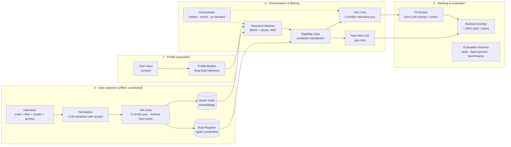

# Architecture

ACCESS is a **neuro-symbolic, multi-agent workflow**: language models read, judge and write; deterministic code
searches, decides eligibility and scores. No model is trained; all are pretrained and used through prompting or
embeddings, on free tiers or locally.

## Components → code

| Layer | Component | Module(s) | Method (see [DECISIONS.md](DECISIONS.md)) |
|---|---|---|---|
| 0 | Harvester | `discover.py`, `agents.py` (scout, scraper, renderer), `recovery.py`, `hubs.py`, `connectors.py`, `harvester.py`, `fetchlog.py` | Breadth-first crawl, heuristic filter, SHA-256 fingerprints, Playwright, Internet Archive fallback |
| 0 | Normalizer | `normalizer.py`, `schema.py` | Zero-shot schema-constrained LLM extraction with evidence quotes |
| 0 | Info Critic (ingestion) | `critics.py`, `passages.py` (`claim_excerpt`), `scoring.py` | Three-vendor LLM jury, majority vote, retrieve-then-verify, weighted trust score |
| 0 | Vector Index | `lookup.py` (`embeddings.npy`), `passages.py` (passage vectors) | nomic-embed-text 768-d, exact cosine search |
| 0 | Rule Register | `lookup.py` (`programs.jsonl`, `facets.json`), `schema.py` | Typed constraint knowledge base |
| 1 | User Input | `views/search.py` | Consent, blank-means-unknown, name-free storage |
| 1 | Profile Builder | `profile.py` (`local_profile`, `infer_fields`), `results.py` (`best_follow_up`) | Zero-shot embedding classification; greedy information-gain follow-up |
| 2 | Research Matcher | `search.py`, `retrieval.py` | BM25 + dense, weighted Reciprocal Rank Fusion |
| 2 | Eligibility Gate | `gate.py` | Deterministic constraint satisfaction, five-valued outcomes |
| 2 | Near-Miss Set | `gate.py` (`gap_cost`), `search.py` | Soft-constraint relaxation ordered by gap cost |
| 2 | Orchestrator | `pipeline.py` (`instant`, `enrich`, `plan_for`), `llm.py`, `resources.py` | Three-tier workflow, availability-based model routing |
| 2 | Info Critic (online) | `critics.py` (`review_shortlist`) | Two-vendor relevance jury (orders, never removes) |
| 3 | Fit Ranker | `ranker.py` | Joint LLM scoring + late fusion with similarity |
| 3 | Ranked Shortlist | `results.py`, `advisor.py`, `rag.py`, `views/search.py` | Deadline status, de-duplication, on-demand plans, RAG Q&A with citations |
| 3 | Evaluation Harness | `bench.py`, `evaluation.py`, `auditor.py` | Unit tests, fault injection, known-item retrieval, Fleiss' κ, RAG faithfulness |

## Agents (background processes, `python agents.py start`)

Agents never call each other: they read and write a shared SQLite database (a **blackboard architecture**), so each can
stop, restart or scale independently.

| Agent | Does | Notes |
|---|---|---|
| Scout | Finds sites to crawl (seeds, outlinks, index pages), runs recovery | One site per domain at a time |
| Scraper | Crawls sites; Annotator threads (Normalizer); Renderer thread (JavaScript pages, re-reads) | Region-fair queue: the region with the fewest verified programmes first |
| Critic | Three-judge panel, trust score, rebuilds the search library every 15 verified rows | Full panel only; benched judges are substituted |
| Auditor | Blind re-extraction (leave-one-out), fault injection, band calibration | Never grades its own votes |
| Sentinel | Monitors progress every 5 min, diagnoses, applies whitelisted fixes, phone alerts | Rules first; an LLM may only choose from safe actions |

## A search request

1. **`instant()`**, about 0.3 s, no cloud AI: profile from the form + local field inference → hybrid retrieval over
   the library → Eligibility Gate on every candidate → de-duplication + deadline status → results on screen.
2. **`enrich()`**, about 15 s, in the background: two reviewers (top 15 + 5 near-misses, batches of 10) and the fit
   ranker reorder and annotate; failures keep the similarity order.
3. **On demand**: `plan_for()` writes an application plan from the record plus retrieved page passages; `rag.ask()`
   answers a question from retrieved passages with citations and a faithfulness check.

## Models (all free tiers or local)

| Role | Model (company · where) |
|---|---|
| Annotator (Normalizer) | Gemini Flash family (Google · Gemini API) |
| Judge pool (3 per record, never the annotator's company) | GPT-OSS-120B (OpenAI · Groq), Qwen 27B (Alibaba · Groq), Nemotron 3 Super (NVIDIA · NIM), GLM-5.3 Flash (Zhipu · NIM), Phi-4-mini (Microsoft · local), Muse Glimmer 30B (Meta · NIM) |
| Shortlist reviewers | GPT-OSS-120B, Phi-4-mini |
| Fit ranker | Qwen 27B |
| Plan writer / RAG answers | first available: Gemini Flash → Nemotron → GLM → Qwen |
| Auditor | Qwen 27B (leave-one-out) |
| Embeddings | nomic-embed-text (local) |

## Data stores

| Store | Contents |
|---|---|
| `data/access.db` (SQLite, WAL) | sites, pages (`sources`), verified listings, audits, mutation tests, stubs, render queue |
| `data/fetchlog.db` | one row per crawl request (outcome, status, latency): the crawl datalog |
| `data/lookup/` | the published search library: `programs.jsonl/.csv`, `facets.json`, `embeddings.npy`, data dictionary, calibration |
| `data/eval/` | benchmark query sets and results |
| `data/cache/` | LLM response cache, quota ledgers, cooldowns, passage vectors |
